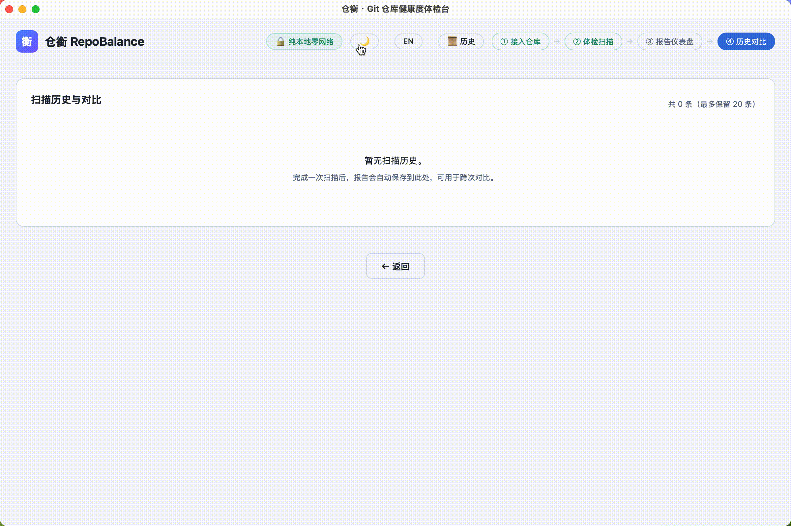
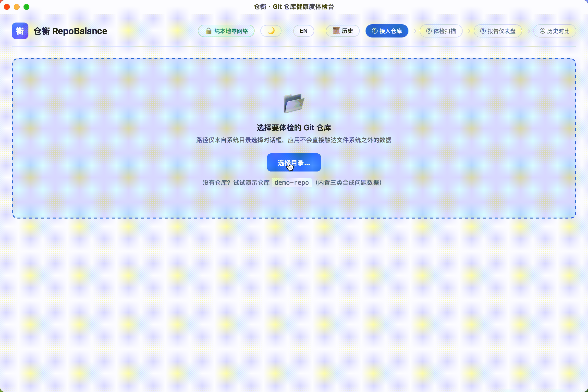

# 仓衡 RepoBalance

[简体中文](README.md) | English

[](https://atomgit.com/dickeryang/repo-balance)
[](https://atomgit.com/dickeryang/repo-balance)
[](https://atomgit.com/dickeryang/repo-balance)
[](https://atomgit.com/dickeryang/repo-balance/releases)
[](https://github.com/dickeryang/repo-balance/actions/workflows/ci.yml)

RepoBalance ("仓衡", *cāng héng* — a granary scale) is a cross-platform desktop app that runs a structured health checkup on your local Git repositories: large files, zombie branches, commit habits, dependency health and leaked secrets, producing an exportable checkup report. It was built independently with the Huawei Cloud CodeArts coding agent.

**Everything stays on your machine** — no network requests, no telemetry, and secret evidence is masked before it ever leaves the Rust core.

## Hosting & Sync

The canonical hosting for China is **AtomGit**, and the project joins the [AtomGit G-Star Program](https://atomgit.com/GitCode/G-Star_guiding).

<a href="https://atomgit.com/dickeryang/repo-balance"></a> [Hosted on AtomGit: https://atomgit.com/dickeryang/repo-balance](https://atomgit.com/dickeryang/repo-balance)

| Platform | URL | Notes |
|---|---|---|
| AtomGit (canonical in China) | https://atomgit.com/dickeryang/repo-balance | Official host; where the G-Star certification lives |
| GitHub (international mirror) | https://github.com/dickeryang/repo-balance | Kept in sync with AtomGit |

> **Sync policy:** every release pushes the same commit to both remotes. G-Star requires that a mirrored platform never falls more than one month behind, otherwise AtomGit may revoke the certification — so "push to both remotes" is a mandatory release step here.

## Demo

**Pick a repository and start the checkup:**



**Scan history comparison (new / resolved findings):**



### Generate the demo repository (see every checker in action)

`demo-repo/` is a synthetic sample generated locally (it is git-ignored, so a fresh clone does not contain it). One command creates it:

```bash
bash scripts/build-demo-fixture.sh
```

The script is **idempotent** and never rewrites or amends existing commits. It produces four kinds of synthetic data:

| Fixture | Checker it exercises |
|---|---|
| `big.bin` (5 MiB, committed and still in the worktree) | Big files · Warning |
| `.env` (with assignments) | Leaked secrets · Warning |
| `old-branch` (holds an unmerged `wip` commit) | Zombie branches · Info |
| `leaked.txt` (`DEMO KEY` placeholder block) | The secrets stop-word allowlist (produces no finding) |

Then either click "试试演示仓库 demo-repo" in the app, or scan it from the CLI:

```bash
cargo run -p rb-core --bin rb scan ./demo-repo
```

## Tech Stack

| Layer | Technology |
|---|---|
| Desktop shell | Tauri 2 (native Rust WebView, zero Electron) |
| Frontend | Vue 3 + TypeScript + Pinia + Vite 4 |
| Checker core | Rust (git2 + rayon + serde + thiserror) |
| IPC | Tauri IPC (invoke commands + emit events) |

## Prerequisites

| Tool | Minimum | Notes |
|---|---|---|
| Rust | 1.88+ | Dependency-graph MSRV floor (`darling` / `plist` / `time` declare 1.88); `rustup update stable` |
| Node.js | 14.18+ | Required by Vite 4 |
| npm | 6+ | or pnpm / yarn |
| Windows SDK | 10+ | Windows builds only (`dbghelp.lib` + `advapi32.lib`) |

### Install the Tauri CLI

```bash
cargo install tauri-cli --version "^2"
```

## Development

### 1. Install frontend dependencies

```bash
cd ui
npm install --registry https://registry.npmjs.org/
cd ..
```

> If your npm default registry is an internal mirror, pass `--registry https://registry.npmjs.org/` — packages such as `@tauri-apps/api` must come from the official registry.

### 2. Start the dev server

**Option A (recommended): one-shot Tauri dev**

```bash
cargo tauri dev
```

This starts the Vite dev server (port 5173) plus Rust hot reload and opens a 1200×800 desktop window.

**Option B: separate terminals**

```bash
# Terminal 1: frontend dev server
cd ui && npm run dev

# Terminal 2: Rust side
cargo run -p rb-app
```

### 3. Quality gates

These are exactly the checks CI runs ([`.github/workflows/ci.yml`](.github/workflows/ci.yml)) — please run them locally before pushing:

```bash
# Rust formatting (rustfmt)
cargo fmt --all -- --check

# Rust lint (warnings are errors)
cargo clippy --all-targets --workspace -- -D warnings

# Rust tests
cargo test --workspace

# Frontend lint + build
cd ui && npm run lint && npm run build
```

> CI also runs two separate jobs: **dependency licence & vulnerability audit** (cargo-deny, configured in [`deny.toml`](deny.toml)) and a **rb-core coverage summary** (cargo-llvm-cov).

## Build & Release

### Production build

```bash
cargo tauri build
```

This runs, in order:

1. `npm run build` (frontend output → `ui/dist/`)
2. `cargo build --release -p rb-app --features custom-protocol` (optimized Rust build, frontend assets embedded)
3. Platform installer packaging

Artifacts land in `target/release/bundle/`:

| Platform | Artifact | Path |
|---|---|---|
| Windows | `.msi` installer + `.exe` | `target/release/bundle/msi/` |
| Windows | NSIS `.exe` installer | `target/release/bundle/nsis/` |
| macOS | `.dmg` + `.app` | `target/release/bundle/dmg/` |
| Linux | `.deb` + `.AppImage` | `target/release/bundle/deb/` |

### Installing and first launch (unsigned builds)

Release artifacts are **not code-signed** (the usual state for open-source projects), so the OS will block the first launch:

| Platform | Prompt | Workaround |
|---|---|---|
| macOS | "Apple could not verify … is free of malware" | Right-click the app → Open; or `xattr -dr com.apple.quarantine "/Applications/仓衡.app"` |
| Windows | SmartScreen warning | "More info" → "Run anyway" |

If that is not acceptable to you, build from source — every build step above is reproducible locally.

### Frontend only (no desktop bundle)

```bash
cd ui && npm run build
```

Produces `ui/dist/` (`index.html` + `assets/`), usable as a web preview or embedded in another container.

### Rust binary only (no installer)

```bash
cargo build --release -p rb-app --features custom-protocol
```

Produces `target/release/rb-app` (`rb-app.exe` on Windows) with the frontend assets already embedded — runnable directly.

> ⚠️ `--features custom-protocol` is **required**. Without it Tauri compiles in dev mode (`tauri-build` sets `cfg(dev)`), which does not embed the frontend and instead loads it from `devUrl` (`http://localhost:5173`); with no dev server running the window renders blank.

## CLI Mode (no GUI)

`rb-core` also compiles as a standalone command-line tool with no Tauri dependency:

```bash
cargo run -p rb-core --bin rb scan ./demo-repo
```

It prints the repository summary plus the checkup findings (severity, masked evidence, remediation advice).

## Project Structure

```
repo-balance/
├── crates/
│   ├── rb-core/              # Checker core (zero Tauri dependency)
│   │   ├── src/
│   │   │   ├── checker/      # Checker trait + registry + slice plan + context + 5 built-in checkers
│   │   │   ├── engine/       # Scan orchestration (plan → merge → collect → check)
│   │   │   ├── git/          # Read-only git2 facade (no type leakage)
│   │   │   ├── model/        # Data models (RepoSnapshot / Finding / ScanReport)
│   │   │   └── bin/rb.rs     # CLI entry point
│   │   └── build.rs          # Windows advapi32 link fixup
│   └── rb-app/              # Tauri 2 desktop shell
│       ├── src/
│       │   ├── main.rs       # Tauri Builder entry
│       │   ├── commands.rs   # IPC commands (5)
│       │   ├── dto.rs        # camelCase DTO mirror layer
│       │   ├── error.rs      # Error mapping
│       │   └── state.rs      # Scan state management
│       ├── capabilities/     # Minimal permission set
│       ├── icons/            # App icons
│       ├── tauri.conf.json   # Tauri config (CSP / window / bundling)
│       └── build.rs          # tauri-build
├── ui/                       # Vue 3 frontend project
│   ├── src/
│   │   ├── views/            # Views (connect / scan / report / history)
│   │   ├── components/       # Shared components (TopBar / RadarChart)
│   │   ├── stores/           # Pinia state stores
│   │   ├── ipc/              # IPC wrapper (commands + events)
│   │   ├── styles/           # Theme styles (14 CSS variables)
│   │   └── types/            # TS type mirrors
│   ├── package.json
│   └── vite.config.ts
├── docs/                     # Documentation (roadmap / CI integration / demo GIFs / prototype)
│   ├── roadmap.md            # Authoritative roadmap (current state / goals / acceptance)
│   ├── ci-integration.md     # CI integration guide
│   └── prototype/            # Product prototype HTML
├── design/                   # Brand assets
│   ├── icon.svg              # App icon source
│   ├── preview.png           # 1024×1024 icon preview (usable directly as a repo avatar)
│   └── preview-64.png        # 64×64 icon
├── scripts/                  # Fixture scripts (build-demo-fixture.sh)
└── Cargo.toml                # Workspace root
```

## Security Design

- **CSP**: `default-src 'self'` (no external resource loading)
- **Minimal permissions**: `core:default` + `dialog:allow-open` + `core:event:default` (no fs/shell)
- **Path sources**: system directory picker only — no free-text path input
- **Fully local, zero network**: nothing is ever sent to a remote server
- **Masked evidence**: evidence is masked when constructed in `rb-core`; export/IPC never restores it
- **Zero Tauri dependency in `rb-core`**: the core compiles as a standalone CLI, decoupled from any UI framework

## Built-in Checkers

| Checker | Dimension | Rules |
|---|---|---|
| `big-files` | Structure | Large files in the worktree and in history (threshold configurable, 1 MiB default) |
| `secrets` | Security | Private-key headers, AWS access keys, GitHub/GitLab tokens, `.env` assignments, high-entropy secrets (regex + Shannon entropy, with a stop-word allowlist) |
| `zombie-branches` | Branches | Merged but undeleted, inactive beyond N days (90 by default), local branches without upstream |
| `commit-habits` | History | Oversized commits (>50 files Warning / >200 Critical), low-quality message ratio, late-night commit ratio (per commit timezone) |
| `deps-health` | Dependencies | Missing / uncommitted / deleted lockfiles, multiple package managers in one ecosystem |

Dimensions with no registered checker score `None` (shown as **N/A**) instead of a fake 100, and the total score averages only the covered dimensions.

## Roadmap

> The full roadmap (current state, phase goals, acceptance criteria) lives in [`docs/roadmap.md`](docs/roadmap.md) (Chinese).
> The list below is a summary only; unimplemented features are never marked as done — documentation never runs ahead of the code.

### Shipped in the current version (v0.1.x)

- [x] **All five checkers live** — large files (structure), secrets (security), zombie branches (branches), commit habits (history), dependency health (deps): every dimension produces real findings
- [x] **Secrets checker** — private-key headers / AWS access key / GitHub & GitLab tokens / `.env` assignments / high-entropy secrets, dual-channel (regex + Shannon entropy), evidence masked at construction, stop-word allowlist for sample values
- [x] **Zombie branches checker** — merged but undeleted, inactive beyond N days (90 default, configurable), no upstream tracking
- [x] **Commit habits checker** — oversized commits (>50 files Warning / >200 Critical), low-quality message ratio, late-night ratio (per commit timezone)
- [x] **Dependency health checker (lite)** — missing / uncommitted / deleted lockfiles, mixed package managers (structural checks only; a vulnerability database is a mid-term item)
- [x] **Scoring fix** — dimensions without a checker show N/A instead of 100; the total score averages covered dimensions only
- [x] **Report export** — JSON / Markdown / HTML (self-contained, inline SVG radar chart)
- [x] **Scan history** — persisted locally; compare two scans (new / resolved findings)
- [x] **Ignore rules** — `.repobalance-ignore` with negated rules (`!pattern`); built-in defaults for build output (`target/`, `node_modules/`, …) that can be negated
- [x] **CI integration** — GitHub Actions pipeline running the checkup in CLI mode and uploading the report
- [x] **i18n** — Chinese / English UI toggle

### Next (v0.2 ~ v0.3)

- [ ] **History persistence migration** — localStorage → app data directory, with export support
- [ ] **PDF export**

### Mid / long term (v0.5 → v1.0)

- [ ] **Dependency vulnerability detection** — integrate the offline OSV database to cover the whole stack in one tool
- [ ] **Remote repository checkup** — shallow-clone a URL, scan locally, clean up
- [ ] **Bulk multi-repository checkup** — scan queue plus an aggregate dashboard for team governance
- [ ] **Health trend analysis** — quality evolution curves from historical data
- [ ] **Custom rules** — JSON-driven config, later evolving into a WASM sandbox plugin system
- [ ] **Official GitHub Action**, auto-update, Homebrew / Scoop / Winget distribution
- [ ] **Team report collaboration** — Report as Code, closing remediation items through PR review

## Contributing

Issues and PRs are welcome. The full workflow, code discipline and the three-step recipe for adding a checker are in [`CONTRIBUTING_EN.md`](CONTRIBUTING_EN.md) ([简体中文](CONTRIBUTING.md)).

- Before filing anything, check [`SUPPORT.md`](SUPPORT.md) (Chinese — unsigned builds, false positives, how the score is computed)
- Bugs and feature requests: use the [issue templates](.github/ISSUE_TEMPLATE)
- Pull requests: check off the validation list in the [PR template](.github/PULL_REQUEST_TEMPLATE.md)
- Community standards: [`CODE_OF_CONDUCT_EN.md`](CODE_OF_CONDUCT_EN.md) ([简体中文](CODE_OF_CONDUCT.md))
- Security issues: **do not** open a public issue — use the private channels in [`SECURITY_EN.md`](SECURITY_EN.md) ([简体中文](SECURITY.md))
- Governance and roles: [`GOVERNANCE.md`](GOVERNANCE.md) (Chinese) | Contributors: [`AUTHORS.md`](AUTHORS.md) (Chinese)
- Release notes: [`CHANGELOG.md`](CHANGELOG.md) (Chinese)

## License

Released under the [Apache License 2.0](LICENSE).
